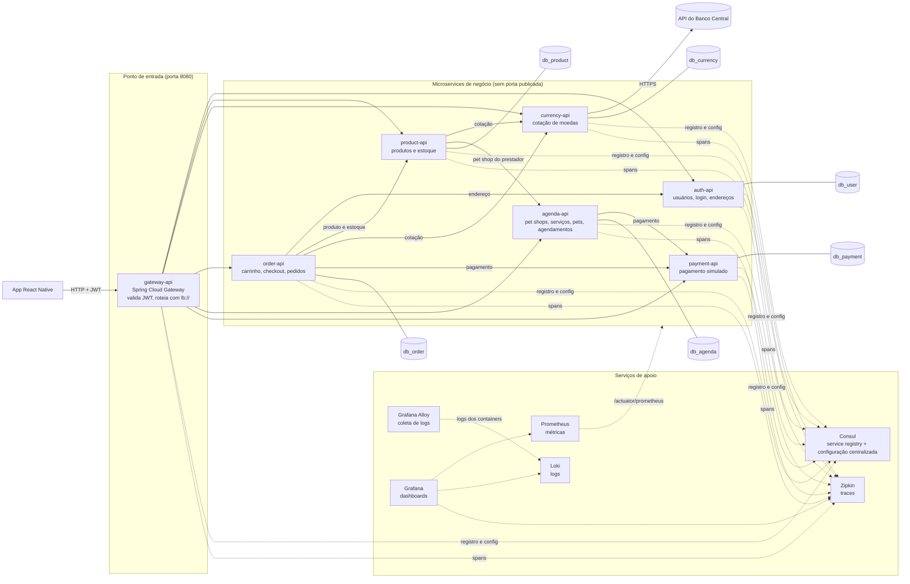

# Arquitetura do backend

Backend de um marketplace de pet shops: o prestador cadastra o pet shop, os produtos, os serviços e a grade de horários; o cliente compra produtos e agenda serviços para os pets. A solução é dividida em microservices em Java 25 com Spring Boot 4 e Spring Cloud, e sobe inteira pelo Docker Compose.

## Diagrama geral

Setas cheias: chamadas HTTP síncronas. Setas tracejadas: registro, configuração e telemetria.

## Microservices

| Serviço | Porta interna | Banco | Responsabilidade |
| --- | --- | --- | --- |
| gateway-api | 8080 (publicada) | | Único ponto de entrada. Roteia as requisições para os serviços pelo nome no Consul, valida o JWT nas rotas `/ws/**`, repassa a identidade do usuário e responde o CORS |
| auth-api | 8200 | db_user | Cadastro de clientes e prestadores, login (gera o JWT), perfil, troca de senha e endereços |
| product-api | 8000 | db_product | Catálogo dos pet shops, busca com filtros, controle e reserva de estoque |
| currency-api | 8100 | db_currency | Cotação entre moedas consultando a API do Banco Central |
| order-api | 8300 | db_order | Carrinho, checkout, pagamento e ciclo de vida dos pedidos |
| agenda-api | 8400 | db_agenda | Pet shops, serviços, grade de atendimento, pets dos clientes e agendamentos |
| payment-api | 8700 | db_payment | Registro dos pagamentos (simulado, sempre aprovado) e histórico do usuário |

## Serviços de apoio

| Serviço | Porta | Função |
| --- | --- | --- |
| Consul | 8500 | Service registry (os serviços se registram sozinhos ao subir) e configuração centralizada (KV em `config/<serviço>/` e `config/application/`) |
| consul-config | | Container que roda uma vez ao subir o ambiente e carrega as configurações no Consul (`docker/config/load-config.sh`) |
| PostgreSQL (6 instâncias) | | Um banco por microservice, com volume Docker próprio |
| Zipkin | 9411 | Distributed tracing |
| Prometheus | 9090 | Coleta as métricas de `/actuator/prometheus` de cada serviço a cada 15 s |
| Grafana Alloy | 12345 | Lê os logs dos containers pelo Docker e envia ao Loki |
| Loki | 3100 | Armazena e consulta os logs |
| Grafana | 3000 | Dashboards de métricas, consulta de logs e traces, com datasources e o dashboard "Microservices Overview" já provisionados |

## Comunicação entre os serviços

A comunicação é HTTP síncrona com `RestClient` e interfaces `@HttpExchange`. A URL base de cada client é o nome do serviço (`http://payment-api`) e o `RestClient.Builder` é `@LoadBalanced`, então o endereço real é resolvido no Consul a cada chamada (client-side discovery). Nenhum serviço conhece IP ou porta de outro.

| Origem | Destino | Para quê | Timeout (conexão/leitura) | Retry | Circuit Breaker |
| --- | --- | --- | --- | --- | --- |
| order-api | product-api | Dados do produto no carrinho | 1 s / 2 s | 3 tentativas | sim |
| order-api | product-api (estoque) | Reservar e devolver estoque | 1 s / 2 s | não | sim |
| order-api | auth-api | Endereço de entrega no checkout | 1 s / 2 s | não | sim |
| order-api | payment-api | Pagar o pedido | 1 s / 2 s | 3 tentativas | sim |
| order-api | currency-api | Converter os preços | 1 s / 2 s | 3 tentativas | sim |
| agenda-api | payment-api | Pagar o agendamento | 1 s / 2 s | 3 tentativas | sim |
| product-api | currency-api | Converter o preço (com cache Caffeine de 10 min) | 1 s / 2 s | 3 tentativas | sim |
| product-api | agenda-api | Descobrir o pet shop do prestador ao cadastrar produto | 1 s / 2 s | não | não |
| currency-api | Banco Central | Cotação (com cache Caffeine de 10 min) | 2 s / 5 s | 3 tentativas | sim |

Os parâmetros do Resilience4j ficam no Consul. Os circuit breakers abrem com 50% de falha em uma janela de 5 chamadas e ficam abertos por 100 s. O retry ignora erros 4xx e circuito aberto, para não repetir o que não vai mudar.

Quando um serviço dependente cai, a falha fica isolada na funcionalidade que depende dele: o serviço que chamou responde 503 com mensagem em português e o resto do sistema continua funcionando. Por exemplo, com o payment-api fora, o pagamento retorna 503 e o pedido continua `PENDING_PAYMENT`, mas carrinho, catálogo e agenda funcionam normalmente.

As rotas usadas só entre os serviços ficam em `/internal/**` e não estão no gateway, então não podem ser chamadas de fora.

## Autenticação stateless

1. O cliente chama `POST /auth/signin`. O auth-api confere e-mail e senha (BCrypt) e devolve um JWT assinado com HMAC-SHA256, válido por 24 h, com os claims `id`, `email` e `type`.
2. Nas rotas `/ws/**`, o `AuthFilter` do gateway exige o header `Authorization: Bearer <token>` e valida a assinatura e a expiração. Token ausente ou inválido: 401, e a requisição não chega aos serviços.
3. Com o token válido, o gateway repassa a identidade nos headers `X-User-Id`, `X-User-Type` e `X-User-Email`. Esses headers são sempre removidos da requisição original antes, então o cliente não consegue forjar outra identidade.
4. Cada microservice usa esses headers para a autorização: confere o tipo de usuário (403 se for o tipo errado) e se o recurso pertence a ele (404 se for de outro usuário).

Nenhum serviço guarda sessão e não há nova autenticação entre os serviços. A chave do JWT é a mesma no auth-api e no gateway e chega por variável de ambiente.

Rotas públicas: `/auth/**`, `/products/**`, `/currencies/**` e `/agenda/**` (só consulta). Todo o resto fica em `/ws/**`.

## Configuração

- **Centralizada:** as configurações de cada serviço (porta, URL do banco, Resilience4j, cache, tracing, métricas) ficam no KV do Consul e são carregadas no início pelo `spring.config.import=consul:`. O container `consul-config` grava tudo a partir do `docker/config/load-config.sh`.
- **Externalizada:** as imagens Docker não têm configuração de ambiente. O compose informa só onde está o Consul e os segredos, então a mesma imagem roda em outro ambiente trocando apenas o Consul e o `.env`.
- **Segredos:** o usuário e a senha dos bancos, a chave do JWT e a senha do Grafana ficam no `docker/.env`, que não vai para o git (o repositório tem só o `.env.example`). Eles chegam aos containers por variável de ambiente (`SPRING_DATASOURCE_USERNAME`, `SPRING_DATASOURCE_PASSWORD` e `APP_JWT_SECRET`), que tem prioridade sobre o Consul no Spring.

## Persistência

Cada microservice de negócio tem seu próprio PostgreSQL (Database per Service), e nenhum serviço acessa a tabela de outro: quando precisa de um dado, chama a API do dono. Por isso o pedido guarda uma cópia dos dados do produto e do endereço no checkout, e o agendamento guarda o nome e a espécie do pet. Assim o histórico continua consultável mesmo se o produto, o endereço ou o pet mudarem ou forem removidos.

O esquema de cada banco é criado e versionado pelo Flyway (`src/main/resources/db/migration`), com `ddl-auto=none` no Hibernate.

## Observabilidade

- **Logs:** os serviços escrevem no stdout com o `traceId` e o `spanId` em cada linha. O Alloy coleta os logs dos containers e envia ao Loki, consultado pelo Grafana (`{container_name=~".*order-api.*"}`).
- **Métricas:** o Actuator com Micrometer expõe `/actuator/prometheus` (memória, CPU, requisições HTTP com histograma, disponibilidade, banco). O Prometheus coleta e o Grafana mostra no dashboard "Microservices Overview" (disponibilidade, requisições/s, taxa de 5xx, latência p95 e heap da JVM).
- **Traces:** Micrometer Tracing com Brave, 100% de amostragem, exportando ao Zipkin. Um checkout (`POST /ws/orders/checkout`), por exemplo, aparece no Zipkin como um único trace: gateway-api, order-api, auth-api (busca do endereço) e product-api (reserva do estoque), com o tempo de cada trecho. Se algum produto estiver em outra moeda, o currency-api também aparece. O mesmo `traceId` sai nos logs, então dá para achar no Loki as linhas de log daquela requisição.

## Containers

Cada serviço tem seu Dockerfile multi-stage (build com Maven e imagem final só com o JRE, rodando com usuário sem privilégios) e roda no seu próprio container. O `docker/docker-compose.yml` sobe todo o ambiente com um comando, na ordem certa: Consul saudável, depois as configurações carregadas e os bancos saudáveis (healthcheck com `pg_isready`), e só então os serviços. Os dados dos bancos, do Prometheus, do Loki e do Grafana ficam em volumes Docker.

## Decisões e adaptações

- **Database per Service com seis instâncias de PostgreSQL**, em vez de um banco compartilhado, para manter o isolamento entre os serviços. O custo é mais memória no ambiente local.
- **Cópia de dados entre serviços** (produto e endereço no pedido, pet no agendamento) em vez de joins entre bancos, consequência do Database per Service.
- **Estoque e endereço sem retry.** A reserva de estoque não é idempotente: repetir uma chamada que deu timeout mas foi processada reservaria o estoque duas vezes. A busca de endereço só acontece no checkout e falha rápido. Nos dois casos ficam o timeout e o circuit breaker.
- **product-api para agenda-api só com timeout.** A chamada só acontece quando o prestador cadastra um produto, e sem o pet shop o produto não pode ser criado. Se a agenda estiver fora, o cadastro falha e o resto do catálogo continua funcionando.
- **Segredos fora do Consul.** Credenciais e a chave do JWT vão por variável de ambiente, porque o Consul roda em modo dev, sem ACL, com a interface aberta na porta 8500.
- **Pagamento simulado.** O payment-api sempre aprova, mas registra cada pagamento e é idempotente por referência (pagar o mesmo pedido de novo retorna 409).
- **Autorização em cada serviço.** O gateway só autentica. As regras de quem pode fazer o quê ficam no serviço dono do recurso, que conhece o domínio.

Documentação dos endpoints, com cURL de cada um: [ENDPOINTS.md](ENDPOINTS.md).
